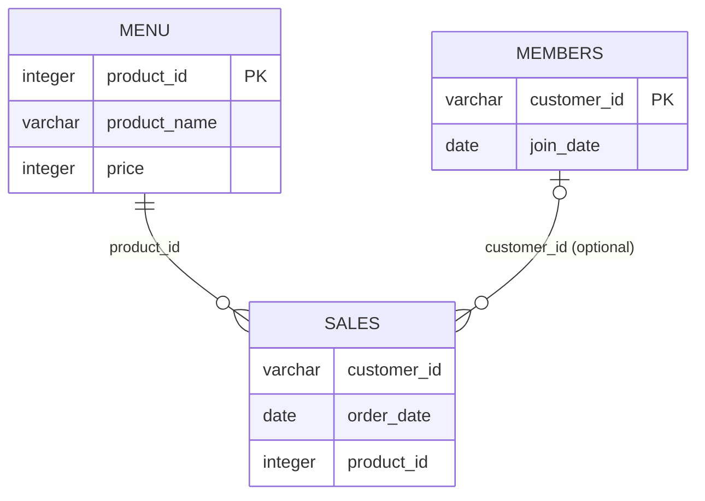
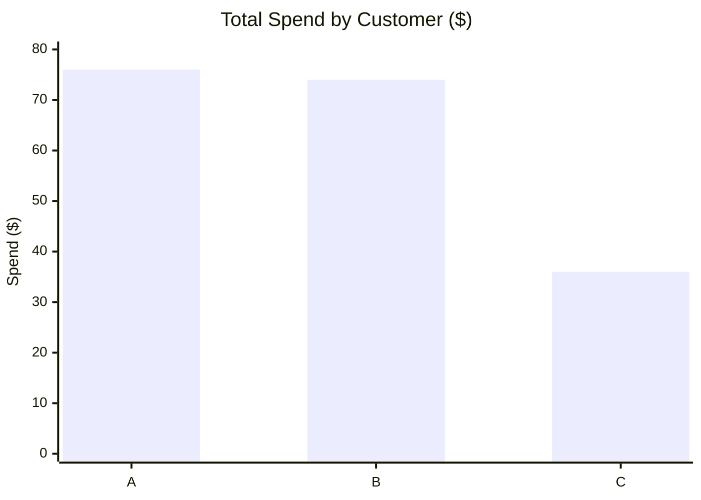
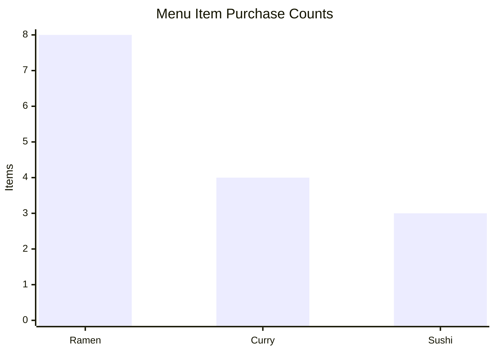

<div align="center">

# 🍜 Danny's Diner — SQL Case Study

### Week 01 · 8 Week SQL Challenge

**Exploring customer purchasing behavior, menu preferences, and loyalty program performance with PostgreSQL.**


[← Back to Challenge Home](../README.md) · [SQL Solutions](./solutions.sql) · [Database Setup](./schema.sql) · [Run on DB Fiddle](https://www.db-fiddle.com/f/2rM8RAnq7h5LLDTzZiRWcd/11472)

</div>

---

## 📌 Case Study Overview

**Danny's Diner** is the first case study in [Data With Danny's 8 Week SQL Challenge](https://8weeksqlchallenge.com/case-study-1/). Danny runs a small Japanese restaurant selling sushi, curry, and ramen. He wants to better understand customer visits, spending, favorite menu items, and the impact of his membership program.

**Analytical objective:** Turn transaction-level data into interpretable customer and loyalty insights using SQL.

### At a Glance

| Dataset metric | Value |
|:---|---:|
| Customers | **3** |
| Transactions / purchased items | **15** |
| Menu items | **3** |
| Registered members | **2** |
| Total recorded sales | **$186** |
| Main questions solved | **10** |
| Bonus questions solved | **2** |

> **Dataset note:** This is a small illustrative case-study dataset, not a representative sample for measuring real-world business impact. Each row in `sales` represents one purchased item; multiple rows can share the same customer and order date.

---

## 🗂️ Database Schema

The analysis uses three relational tables: `sales`, `menu`, and `members`.



| Table | Purpose | Rows |
|:---|:---|---:|
| `sales` | Item-level customer purchase history | 15 |
| `menu` | Menu item names and prices | 3 |
| `members` | Membership enrollment dates | 2 |

**Important modeling detail:** The diagram shows the *logical join relationships* used in the analysis. The supplied `schema.sql` does **not** declare primary-key or foreign-key constraints. Customer C has purchases but no record in `members`, so `LEFT JOIN` is essential when all customers must be retained.

### Run the Analysis

1. Open the [saved DB Fiddle workspace](https://www.db-fiddle.com/f/2rM8RAnq7h5LLDTzZiRWcd/11472), or start a PostgreSQL 13 environment.
2. Execute [`schema.sql`](./schema.sql) to create and populate the `dannys_diner` schema.
3. Execute queries from [`solutions.sql`](./solutions.sql). You can run them individually or sequentially in a compatible SQL editor.
4. Check that the session uses `SET search_path = dannys_diner;` when working with unqualified table names.

---

## 🎯 Business Questions & SQL Solutions

All **10 main questions and 2 bonus questions** are implemented in [`solutions.sql`](./solutions.sql).

| # | Business question | Main SQL techniques |
|:---:|:---|:---|
| 01 | Total amount spent by each customer | `INNER JOIN`, `SUM`, `GROUP BY` |
| 02 | Number of distinct visit days | `COUNT(DISTINCT)` |
| 03 | First menu item purchased by each customer | CTE, `DENSE_RANK()` |
| 04 | Most purchased menu item overall | `COUNT`, `ORDER BY`, `LIMIT` |
| 05 | Most popular menu item for each customer | CTEs, `DENSE_RANK()` |
| 06 | First item purchased after membership began | Date filtering, window functions |
| 07 | Last item purchased before membership began | Date filtering, descending rank |
| 08 | Items and spending before joining | Three-table join, aggregation |
| 09 | Loyalty points with double points for sushi | `SUM(CASE WHEN ...)` |
| 10 | Loyalty points with first-week promotion | Date intervals, conditional aggregation |
| Bonus 1 | Add membership status to transaction history | `LEFT JOIN`, `CASE WHEN` |
| Bonus 2 | Rank purchases made after becoming a member | CTE, `DENSE_RANK()`, conditional ranking |

### Example: Conditional Aggregation for Loyalty Points

Customers earn **10 points per $1 spent**, with **double points for sushi**:

```sql
SELECT
    s.customer_id,
    SUM(
        CASE
            WHEN m.product_name = 'sushi' THEN m.price * 20
            ELSE m.price * 10
        END
    ) AS total_points
FROM sales AS s
INNER JOIN menu AS m
    ON s.product_id = m.product_id
GROUP BY s.customer_id
ORDER BY total_points DESC;
```

**Why this matters:** `SUM(CASE WHEN ...)` translates a business rule directly into a customer-level KPI without needing separate intermediate tables.

---

## 📊 Key Findings

### 1. Customer Spending

| Customer | Total spend | Distinct visit days |
|:---:|---:|---:|
| A | **$76** | 4 |
| B | **$74** | 6 |
| C | **$36** | 2 |



**Observation:** Customer A spent the most overall, while B visited on the most distinct dates. Total spending and visit frequency do not necessarily produce the same customer ranking.

### 2. Menu Popularity

| Menu item | Items purchased | Unit price |
|:---|---:|---:|
| Ramen | **8** | $12 |
| Curry | 4 | $15 |
| Sushi | 3 | $10 |



**Observation:** Ramen is the most frequently purchased item, accounting for **8 of 15** recorded item purchases. This is a frequency finding, not necessarily a profit finding; costs are not provided.

### 3. Membership & Loyalty

| Metric | Customer A | Customer B |
|:---|---:|---:|
| Membership start | 2021-01-07 | 2021-01-09 |
| Items purchased before joining | 2 | 3 |
| Spending before joining | $25 | $40 |
| Base loyalty points (Question 9) | 860 | 940 |
| January points with first-week promotion (Question 10) | **1,370** | **820** |

**Observation:** Customer B leads under the standard sushi-bonus rule in Question 9, but Customer A leads in the end-of-January promotion calculation in Question 10. These are **different scoring scenarios and time scopes**, so their totals should not be interpreted as a simple before-and-after comparison.

### 4. Membership Status at Purchase Time

The bonus questions classify transactions as:

- **`Y`** — purchased on or after the customer's membership start date.
- **`N`** — purchased before joining, or purchased by someone with no membership record.

The second bonus question then ranks **member purchase dates** within each customer. Purchases on the same date receive the same `DENSE_RANK()` value.

---

## 💡 Business Interpretation & Recommendations

| Finding | Potential business action | Validation needed |
|:---|:---|:---|
| Ramen leads in purchase frequency | Explore ramen-focused promotions or bundles | Check item margins and larger-sample demand |
| Visit frequency differs from total spending | Segment customers by both frequency and monetary value | Observe a longer purchase history |
| Membership-based point rules change customer rankings | Monitor loyalty points alongside actual spend and repeat purchases | Evaluate program costs and incremental behavior |
| Pre-membership purchases can be identified | Compare purchase patterns around enrollment dates | Use more customers and a suitable control/comparison design |

> **Interpretation caution:** The dataset has only three customers and does not establish that membership or promotions *caused* a change in purchasing behavior. The recommendations above are hypotheses to test, not proven outcomes.

---

## 🧠 SQL Skills Demonstrated

| Area | Skills |
|:---|:---|
| Data retrieval | `SELECT`, `WHERE`, `ORDER BY` |
| Relational querying | `INNER JOIN`, `LEFT JOIN` |
| Aggregation | `COUNT(*)`, `COUNT(DISTINCT)`, `SUM`, `GROUP BY` |
| Modular querying | Common Table Expressions (`WITH`) |
| Window functions | `DENSE_RANK()`, `PARTITION BY` |
| Business rules | `CASE WHEN`, conditional aggregation |
| Time-based analysis | Date comparisons, `BETWEEN`, `INTERVAL` |
| Result interpretation | Customer behavior, item popularity, loyalty points |

### Learning Takeaways

- **Understand the grain:** Counting `sales` rows gives items purchased, while `COUNT(DISTINCT order_date)` gives distinct visit days.
- **Preserve unmatched records:** `LEFT JOIN` keeps nonmembers in transaction-level analysis.
- **Handle ties intentionally:** `DENSE_RANK()` returns all items tied for first purchase date or popularity.
- **Translate business policies into SQL:** Ordered `CASE WHEN` conditions implement different point multipliers correctly.
- **Validate the meaning of KPIs:** Points, visits, spending, and item counts answer different questions.

---

## 📁 Files

| File | Description |
|:---|:---|
| [`schema.sql`](./schema.sql) | PostgreSQL schema and sample data |
| [`solutions.sql`](./solutions.sql) | All 10 main SQL answers and 2 bonus solutions |
| [`db-fiddle-link.txt`](./db-fiddle-link.txt) | Saved interactive workspace link |
| `README.md` | Case study overview, SQL techniques, findings, and interpretation |

---

## 📚 Credits & References

- [Danny Ma — 8 Week SQL Challenge, Case Study #1](https://8weeksqlchallenge.com/case-study-1/)
- [Data With Danny](https://www.datawithdanny.com/)
- [PostgreSQL Documentation](https://www.postgresql.org/docs/)
- [DB Fiddle](https://www.db-fiddle.com/)

*The case-study scenario and source dataset are credited to their original creator. SQL solutions and commentary document my own learning and analysis.*

---

<div align="center">

**Week 01 Complete ✅**

[← Return to 8 Week SQL Challenge](../README.md)

</div>
