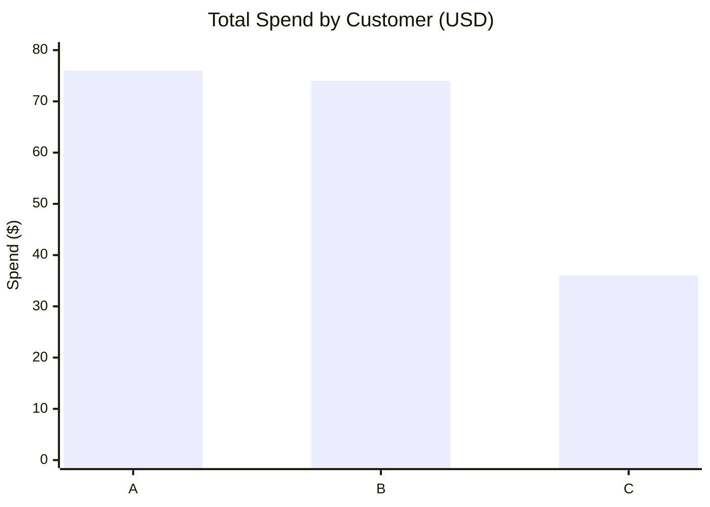
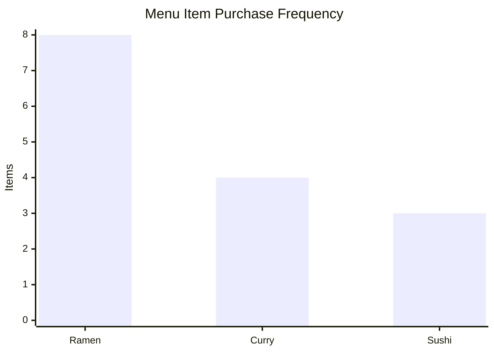

# Business Insights | Week 01 — Danny's Diner

> **Case study:** [Danny's Diner](https://8weeksqlchallenge.com/case-study-1/)  
> **SQL dialect:** PostgreSQL  
> **Scope:** The provided sample transactions, not the restaurant's full operating history  
> **Source files:** [SQL solutions](./solutions.sql) · [Database schema](./schema.sql) · [Case study overview](./README.md)

## Executive Summary

Danny's Diner wants to understand customer purchasing behavior and its membership rewards program. Using the sample `sales`, `menu`, and `members` tables, this analysis examines customer spending, visit frequency, menu popularity, purchase timing around membership enrollment, and loyalty points.

**The central finding:** Customer A has the highest observed spend (**$76**), while **ramen** is the most frequently purchased menu item (**8 items**). The sample also shows that **spending, visits, and loyalty points capture different aspects of customer behavior**—so no single metric should be treated as a complete measure of customer value.

## 1. Performance Snapshot

| Metric | Result | Interpretation |
|---|---:|---|
| Total observed sales value | **$186** | Sum of item prices across all sample transactions |
| Distinct customers | **3** | Customers A, B, and C |
| Total purchased items | **15** | Each row in `sales` represents one item purchase |
| Distinct customer-visit days (summed across customers) | **12** | A: 4 days; B: 6 days; C: 2 days |
| Most frequently purchased item | **Ramen — 8 items** | Highest item count, not necessarily highest revenue |
| Highest-spending customer | **A — $76** | Slightly above B ($74) |
| Membership records | **2 customers** | A and B are members; C is not |

### Customer Spending

| Customer | Total Spend | Share of Observed Sales | Distinct Visit Days | Items Purchased |
|:---:|---:|---:|---:|---:|
| **A** | **$76** | **40.9%** | **4** | **6** |
| **B** | **$74** | **39.8%** | **6** | **6** |
| **C** | **$36** | **19.4%** | **2** | **3** |
| **Total** | **$186** | **100%** | **12** | **15** |

**Insight:** A and B contribute a combined **$150**, or **80.6%** of observed sales, despite differing in visit frequency. A's $2 lead over B is small, so it would be misleading to declare A substantially more valuable based on this limited sample alone.

**Business implication:** Analyze **spend per visit day** alongside total spend. Based on the sample, A averages **$19.00 per visit day**, B **$12.33**, and C **$18.00**. These figures are descriptive, not estimates of long-term behavior.

## 2. Product Popularity

| Menu Item | Items Purchased | Unit Price | Observed Item Revenue |
|---|---:|---:|---:|
| Ramen | **8** | $12 | **$96** |
| Curry | **4** | $15 | **$60** |
| Sushi | **3** | $10 | **$30** |
| **Total** | **15** | — | **$186** |

**Insight:** Ramen accounts for **53.3% of items purchased** and **51.6% of observed revenue**. It is the leading product by both quantity and revenue in this sample. Curry has a higher unit price ($15) but fewer purchases.

**Business implication:** Ramen is a sensible candidate for menu visibility or cross-selling experiments. However, the data contains **no costs, margins, inventory, or customer satisfaction measures**, so a profitability-based recommendation would be premature.

## 3. Customer Preferences and Repeat Behavior

- **Customer A:** Ramen is the most frequently purchased item (**3** purchases).
- **Customer B:** Sushi, curry, and ramen are tied (**2** purchases each); there is **no unique favorite** based on item count.
- **Customer C:** All **3** purchased items are ramen.

**Insight:** Customer preferences vary, even in a small dataset. In particular, B's equal counts across all menu items show why a ranking query should preserve ties rather than arbitrarily return one product.

**Business implication:** Personalized recommendations could be explored—for example, suggesting complementary products to customers who repeatedly purchase ramen. This is an **experiment idea**, not a demonstrated improvement in conversion or revenue.

## 4. Membership and Purchase Timing

| Customer | Joined Membership | Items Before Joining | Spend Before Joining | First Item Purchased On/After Joining |
|:---:|---|---:|---:|---|
| **A** | 2021-01-07 | **2** | **$25** | Curry |
| **B** | 2021-01-09 | **3** | **$40** | Sushi |
| **C** | Not a member | — | — | — |

**Insight:** A and B had purchase activity **before** enrolling in the membership program. This establishes a pre-enrollment baseline, but it **does not prove** that membership caused later purchases or increased spending.

**Business implication:** A proper loyalty-program effectiveness study would need a longer observation window and a credible comparison group, ideally with metrics such as retention, purchase frequency, average spend per visit, and incremental revenue.

## 5. Loyalty Points Analysis

### Standard Program Rules

- Every **$1** spent earns **10 points**.
- **Sushi** earns **2×** the standard rate (**20 points per $1**).
- Points are calculated from all observed purchases, regardless of membership status, for the standard-rules exercise.

| Customer | Points Under Standard Rules |
|:---:|---:|
| **A** | **860** |
| **B** | **940** |
| **C** | **360** |

**Insight:** B earns more points than A (**940 vs. 860**) even though A spends slightly more (**$76 vs. $74**). The difference reflects the sushi multiplier, showing that **rewards earned and money spent are not interchangeable metrics**.

### First-Week Member Promotion

For the separate January promotion exercise, members earn **2× points on all items during their first seven membership days, including their join date**. Outside that period, the standard sushi multiplier still applies. Sushi is **not multiplied twice** during the promotional week.

| Member | Points Through January 31, 2021 |
|:---:|---:|
| **A** | **1,370** |
| **B** | **820** |

**Important:** The standard-rules and promotional results use **different scoring rules and reporting scopes**. They should not be interpreted as a direct before/after causal effect of the promotion.

**Business implication:** A rewards dashboard should separately track spending, points issued, promotional eligibility, and redemption activity. This dataset does not contain redemptions or program costs, so the financial return of the program cannot be calculated.

## 6. Recommendations and Validation Plan

| Priority | Recommendation | Why It Matters | What to Measure Next |
|---|---|---|---|
| 1 | Monitor spend **and** visit frequency together | A and B have similar total spend but different visit patterns | Spend per visit, purchase frequency, retention |
| 2 | Test ramen-focused merchandising or bundles | Ramen leads observed unit sales and revenue | Bundle uptake, incremental sales, contribution margin |
| 3 | Evaluate loyalty incentives with a comparison group | Enrollment timing alone does not establish program impact | Repeat-purchase lift, incremental spend, cost per reward |
| 4 | Segment communications by observed preferences | A, B, and C exhibit different purchase mixes | Offer engagement, conversion, customer satisfaction |

These are **hypotheses for future testing**, not conclusions about what will definitely increase restaurant performance.

## 7. Data Limitations

1. **Very small sample:** Only three customers and 15 purchased items; results are illustrative and cannot be generalized to a wider customer base.
2. **No order or visit identifier:** Multiple purchases on the same date cannot be reliably separated into individual dining sessions. "Visit days" means distinct purchase dates, not confirmed restaurant visits.
3. **No costs or margins:** Revenue and popularity cannot establish product profitability.
4. **No experimental design:** Pre/post membership comparisons do not isolate the effect of joining.
5. **No redemptions or promotion costs:** Loyalty-program ROI cannot be measured.
6. **Limited time coverage:** The data is a short historical sample; it is not evidence of current business performance.

## 8. SQL Techniques Demonstrated

| Technique | Analytical Use |
|---|---|
| `INNER JOIN` / `LEFT JOIN` | Combine purchases, menu prices, and membership details |
| `COUNT(*)` / `COUNT(DISTINCT ...)` | Count purchased items and distinct purchase dates |
| `SUM()` / `GROUP BY` | Aggregate spending and points by customer |
| `CASE WHEN` | Implement item-specific and date-specific reward rules |
| CTEs (`WITH`) | Structure multi-step analysis for readability |
| `DENSE_RANK()` / `PARTITION BY` | Find first, last, and most frequent purchases while retaining ties |
| Date comparison / `INTERVAL` | Define the seven-day promotional eligibility window |

## Conclusion

This case study demonstrates how SQL can turn a simple transactional dataset into a structured view of **customer value, product demand, membership behavior, and reward mechanics**. The strongest takeaway is methodological: **validate the metric definition, preserve ties, respect date boundaries, and separate observed patterns from causal claims**.

---

**Explore more:** [Week 1 README](./README.md) · [SQL solutions](./solutions.sql) · [8 Week SQL Challenge repository](../README.md)  
**Original case study:** [Data With Danny — Danny's Diner](https://8weeksqlchallenge.com/case-study-1/)
